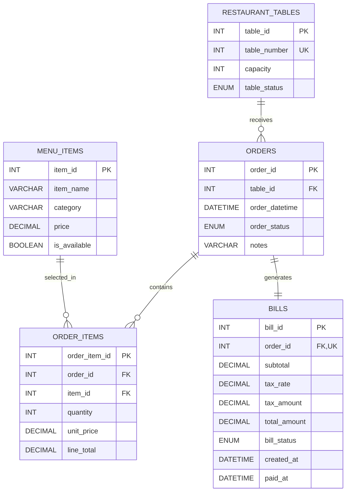

# Entity Relationship Diagram

Paste this Mermaid code into https://mermaid.live to view or export the ER diagram as PNG/SVG.

## Relationship explanation

- One restaurant table can have many orders over time.
- One order contains one or many order items.
- One menu item can appear in many order items.
- Each order has one bill; `bills.order_id` is UNIQUE.
- `order_items.unit_price` stores the price at the time of ordering (price snapshot).
